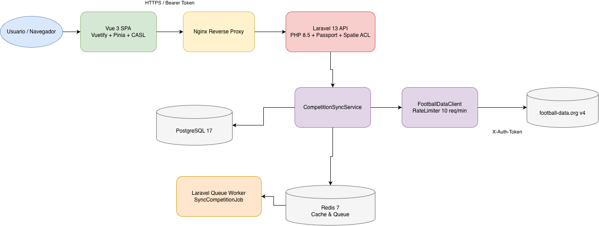

# Inca Rail · Football Data Hub

## Tabla de Contenidos

1. [Arquitectura y Decisiones Técnicas](#arquitectura-y-decisiones-técnicas)
2. [Manejo del Límite de 10 Peticiones por Minuto](#manejo-del-límite-de-10-peticiones-por-minuto)
3. [Diagrama de Arquitectura](#diagrama-de-arquitectura)
4. [Ejecución Paso a Paso con Docker](#ejecución-paso-a-paso-con-docker)
5. [Usuarios de Prueba y Matriz de Permisos](#usuarios-de-prueba-y-matriz-de-permisos)


---

## Arquitectura y Decisiones Técnicas

### Elección de Arquitectura: Laravel + Servicios + Eventos
Para esta solución se evaluaron distintas alternativas arquitectónicas (**DDD**, **Clean Architecture / Hexagonal**, **CQRS** y **Arquitectura en Capas nativa de Laravel**) y se decidió optar por una **Arquitectura en Capas nvativas de Laravel** apoyada en servicios dedicados y eventos:

| Alternativa Evaluada | Decisión | Justificación Técnica |
| :--- | :--- | :--- |
| **DDD (Domain-Driven Design)** | Descartada | El dominio consiste en sincronización de datos externos, persistencia idempotente y ACL; no existen invariantes de negocio complejas que justifiquen entidades puras separadas de Eloquent|
| **Clean / Hexagonal Pura** | Descartada | Reestructurar las carpetas nativas de Laravel para aislar el framework añade fricción y código repetitivo innecesario en un servicio de 5 endpoints.|
| **CQRS** | Descartada | Separar buses de comandos y consultas aporta complejidad accidental cuando 4 de los 5 endpoints son lecturas directas sobre Eloquent y 1 es una importación idempotente. |
| **Capas Nativas + Servicios + EDA** | **Elegida** | Aprovecha al 100% las convenciones de Laravel 13 (**Controladores delgados**, **Form Requests**, **Servicios**, **API Resources**, **Events/Listeners** y **Jobs**), manteniendo alta cohesión, legibilidad y facilidad de prueba. |

---

## Manejo del Límite de 10 Peticiones por Minuto

El plan gratuito de `football-data.org` restringe el consumo a **10 peticiones por minuto**. Para evitar que la aplicación falle o deje de responder al superar esa cuota, se implementaron **4 niveles de defensa**:

1. **Persistencia Local Idempotente (`updateOrCreate`):** Al importar una competición (`GET /api/competitions/{competition_id}`), la liga, sus equipos y sus jugadores (nombre, posición y número de camiseta) se almacenan en PostgreSQL usando `external_id` como clave única. Consultar la misma liga múltiples veces actualiza los registros sin duplicarlos.
2. **Estrategia Cache-Aside con TTL:**
   * El listado general de ligas (`GET /api/competitions`) se almacena en caché Redis por **6 horas** (`football.competitions.list`).
   * El detalle de una liga (`GET /api/competitions/{competition_id}`) tiene una ventana de frescura (`last_synced_at`) de **30 minutos** (configurable vía `FOOTBALL_DATA_CACHE_TTL_MINUTES`). Dentro de ese periodo, las consultas se sirven directamente desde PostgreSQL consumiendo **0 peticiones** hacia la API externa.
3. **Rate Limiter Preventivo Atómico:** `FootballDataClient` utiliza `RateLimiter::attempt('football-data-outbound', 10, ..., 60)` respaldado por Redis antes de emitir cualquier solicitud HTTP saliente. Si se alcanza el tope de 10 llamadas en 60 segundos, bloquea la petición localmente y lanza `ExternalRateLimitExceededException` (`429`) sin saturar el proveedor externo.
4. **Independencia y Degradación Elegante (*Fallback*):**
   * Los endpoints `/api/team`, `/api/team/{team_id}` y `/api/players` operan exclusivamente contra la base de datos local y funcionan incluso si `football-data.org` está caído.
   * Si se solicita refrescar una liga ya importada cuando no hay cupo (`429`) o el servicio externo no responde (`503`), el sistema captura la excepción y devuelve la copia local almacenada con `meta.stale = true`.

---

## Diagrama de Arquitectura

### Arquitectura General (`arquitectura.png`)


Muestra la interacción entre la SPA en Vue 3, el proxy inverso Nginx, la API en Laravel 13 con Passport, el cliente externo aislado con `RateLimiter`, PostgreSQL, Redis y el worker de colas.

---

## Ejecución Paso a Paso con Docker

### Requisitos Previos
* Docker Engine y Docker Compose v2+
* Un token gratuito obtenido en [football-data.org](https://www.football-data.org/client/register)

### Pasos de Instalación

1. **Clonar el repositorio y configurar variables de entorno:**
   ```bash
   git clone https://github.com/rricardo26/prueba-tecnica-incarail.git incarail-fullstack
   cd incarail-fullstack

   cp backend/.env.example backend/.env
   cp frontend/.env.example frontend/.env
   ```

2. **Configurar tu token de `football-data.org`:**
   Edita `backend/.env` y reemplaza `FOOTBALL_DATA_API_KEY` con tu token personal:
   ```env
   FOOTBALL_DATA_API_KEY=tu_token_real_aqui
   ```

3. **Construir y levantar los contenedores:**
   ```bash
   docker compose up -d --build
   ```

4. **Instalar dependencias, ejecutar migraciones, seeders y configurar Passport:**
   ```bash
   docker compose exec app composer install
   docker compose exec app chmod -R 775 storage bootstrap/cache
   docker compose exec app php artisan key:generate
   docker compose exec app php artisan migrate --seed
   docker compose exec app php artisan passport:keys --force
   docker compose exec app php artisan passport:client --personal --name="IncaRail SPA" --no-interaction
   ```

5. **Acceder a la aplicación:**
   * **Frontend (SPA Vue 3):** [http://localhost:5173](http://localhost:5173)
   * **Backend API (Laravel 13):** [http://localhost:8000/api](http://localhost:8000/api)

---

## Usuarios de Prueba y Matriz de Permisos

El seeder `RolesAndUsersSeeder` crea automáticamente dos roles y dos usuarios listos para iniciar sesión (también disponibles mediante botones de autocompletado en la pantalla de Login):

| Rol | Correo Electrónico | Contraseña | Permisos Asignados |
| :--- | :--- | :--- | :--- |
| **`admin`** | `admin@incarail.pe` | `Password123!` | Acceso total: lectura e importación de ligas desde `football-data.org`, consulta de equipos/jugadores y gestión completa de usuarios, roles y permisos. |
| **`viewer`** | `viewer@incarail.pe` | `Password123!` | Solo lectura: puede consultar ligas, equipos y jugadores almacenados localmente (`competitions.read`, `teams.read`, `players.read`), pero no puede importar desde la API externa ni administrar usuarios. |
